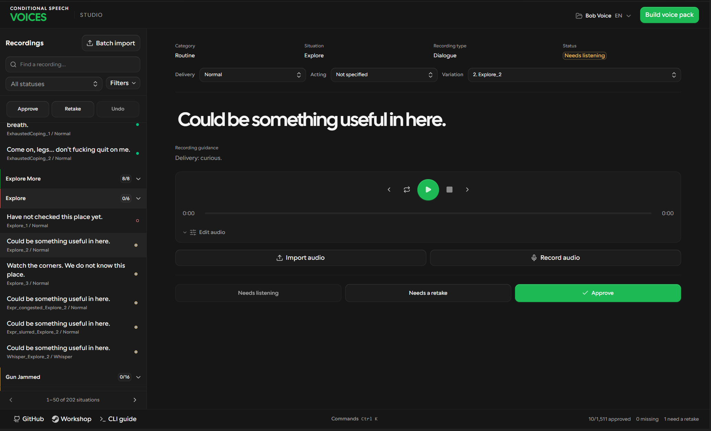

# Conditional Speech Voices - Core

Source code and bug reports for the Core mod, by ravenwits.

Core handles speech rules, playback, settings and debug reports. It requires [Conditional Speech by Chuckleberry Finn](https://steamcommunity.com/sharedfiles/filedetails/?id=2398253681). Core works without a voice pack, but no recorded speech will play until you install a compatible voice pack.

## Status

Version 0.43. Single-player beta. Multiplayer remains unverified. Offline tests do not establish live playback on every game build. See [testing](docs/testing.md) for validation limits.

## Install

Copy `Contents/mods/ConditionalSpeechVoicesCore` into your `Zomboid/mods` folder. Enable Conditional Speech and Core for the save. Add a voice pack for recorded dialogue, then fully restart the game. Avoid enabling a local and Workshop copy of the same mod together.

Mod ID: `Conditional-Speech-Voices-Core`

## Start Studio

Install Python 3.11 or newer and FFmpeg. Pack validation also needs Lua 5.1, LuaJIT, or Neovim. Download or clone this repository and open `Contents/mods/ConditionalSpeechVoicesCore/authoring`.

- On Windows, double-click **Start Studio.cmd**.
- On Linux or macOS, run `sh "Start Studio.sh"` from that directory.

The launcher opens Studio in your browser. Keep the terminal open while you work. The compiled interface is included; Node is needed only to change its source.

Use **New project** in the project picker. Projects are stored under `Zomboid/VoiceProjects` in your home directory. Studio is for creators and is excluded from Workshop packages.

- [Studio creator guide](studio/CREATOR-GUIDE.md)
- [Command-line guide](Contents/mods/ConditionalSpeechVoicesCore/authoring/README.md#command-line)
- [Interface development and source layout](studio/README.md)

## Report a bug

[Open a bug report](https://github.com/ravenwits/conditional-speech-voices-core/issues/new?template=bug-report.yml). English and Turkish reports are welcome.

Enable Speech Debug in Mod Options, reproduce the issue, then use **Debug > Conditional Voices > Save report** from the world right-click menu. Attach `Zomboid/Lua/CSV-report.txt` and relevant `console.txt` lines. Remove private information before posting. If export fails, explain that in the form.

## Development

Run `python tools/check.py` with Lua 5.1 available. These checks cover syntax and isolated Core behavior. They do not prove live audio playback, multiplayer behavior or coverage of every recording. See [testing](docs/testing.md).

See [Core boundaries](docs/architecture.md) for scheduling, event context, Q calls and native injury ownership.

## License

Copyright (c) 2026 ravenwits. [PolyForm Strict 1.0.0](LICENSE.md).

The source is publicly readable. The license permits noncommercial use; it does not grant permission to redistribute, modify or use the software commercially. Ask for written permission before sending code changes or redistributing any part of it. Bug reports and suggestions are welcome.

The original Conditional Speech mod, language packs and recordings are not included in this repository.

## Voice pack authors

See [the provider interface and permission for independent packs](docs/voice-packs.md). Existing save identifiers remain supported.
